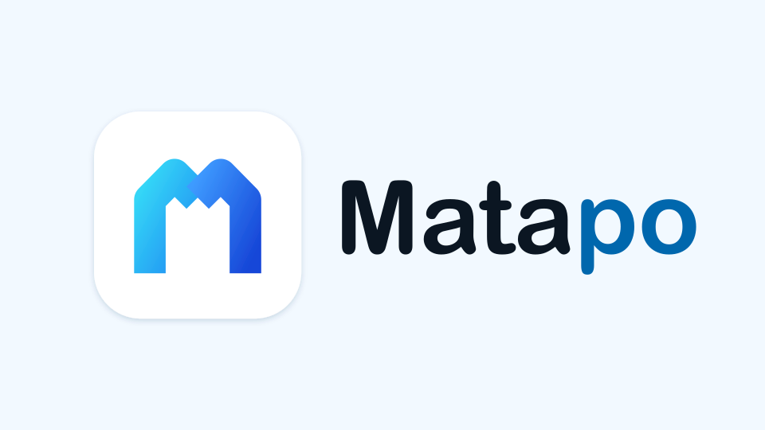
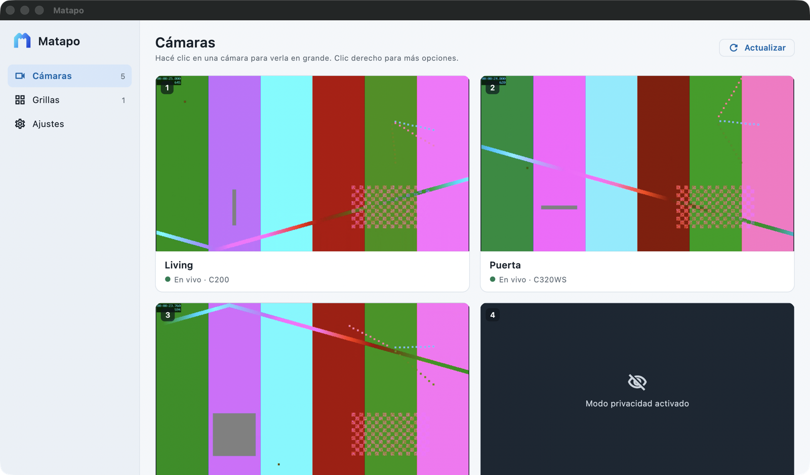
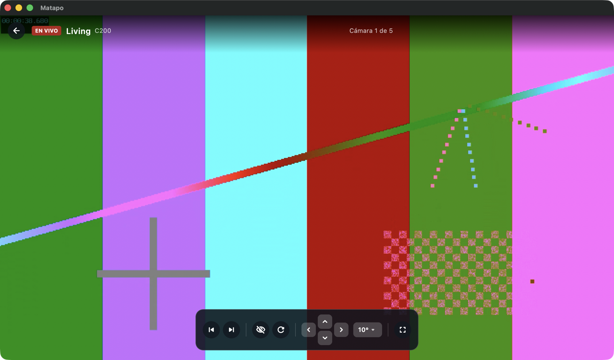
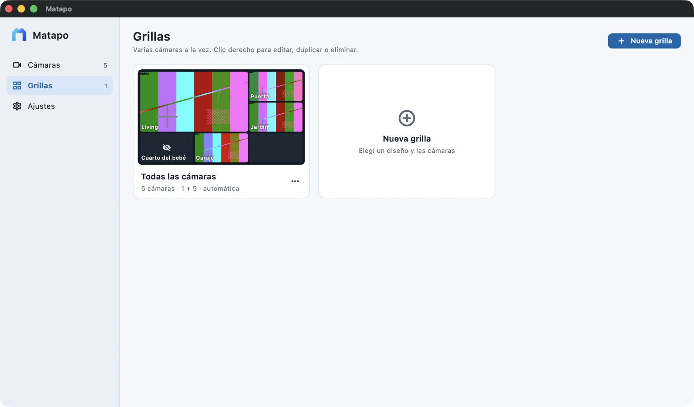
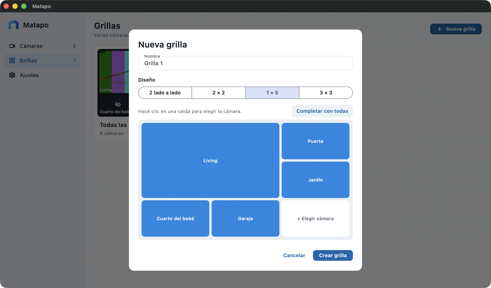

<p align="center">
  
</p>

<h1 align="center">Matapo</h1>

<p align="center">
  <strong>Mirá y controlá tus cámaras Tapo en Android TV y en tu Mac.</strong>
</p>

<p align="center">
  
  
  
  
  
</p>

<p align="center">
  
</p>

> [!NOTE]
> **Matapo parte de [Topo TV](https://github.com/abdulmominsakib/tapo-android-tv),
> creada por [Abdul Momin Sakib](https://github.com/abdulmominsakib).** Todo el
> mérito de la app original es suyo; este repositorio parte de su código (con
> su historial de commits). A su vez, Topo TV se basa en
> [Topo](https://github.com/filirnd/topo) de [filirnd](https://github.com/filirnd).
> Se distribuye bajo la misma [licencia MIT](LICENSE).
>
> **Qué agrega Matapo**
> - Una versión de escritorio para macOS, pensada para mouse y teclado.
> - La interfaz completa en español.
> - Uso como monitor desatendido: la pantalla no se apaga, las cámaras que
>   dejan de responder vuelven a intentarlo solas y el video congelado se
>   reconecta.
> - Grillas en baja resolución, para que entren más cámaras a la vez.

Matapo muestra tus cámaras Tapo a través de la nube de Tapo: iniciás sesión
con tu cuenta y ves todas las cámaras en vivo, grillas de varias cámaras,
movimiento (pan y tilt) y modo privacidad. No hace falta RTSP, abrir puertos,
VPN ni estar en la misma red que las cámaras.

> [!IMPORTANT]
> App no oficial y experimental. Matapo no está afiliada a TP-Link. Usa los
> mismos servicios no documentados de la nube de Tapo que la app de
> escritorio Topo, así que puede dejar de funcionar si Tapo los cambia.

## Contenido

- [Funciones](#funciones)
- [Capturas](#capturas)
- [Uso en la Mac](#uso-en-la-mac)
- [Uso con el control remoto](#uso-con-el-control-remoto)
- [Conexión local (RTSP)](#conexión-local-rtsp)
- [Instalación](#instalación)
- [Compilar desde el código](#compilar-desde-el-código)
- [Cómo funciona](#cómo-funciona)
- [Privacidad y seguridad](#privacidad-y-seguridad)
- [Estado y limitaciones](#estado-y-limitaciones)
- [Créditos y licencia](#créditos-y-licencia)

## Funciones

**Video en vivo**
- Vista previa en vivo de cada cámara, que arrancan de a una para no
  saturar equipos lentos.
- La última imagen de cada cámara aparece al instante mientras conecta.
- Vista en grande con alrededor de un segundo de demora, que se reconecta
  sola si se corta.

**Grillas**
- Varias cámaras a la vez: 2 lado a lado, 2 × 2, 1 + 5 o 3 × 3.
- Una grilla automática, **Todas las cámaras**, que siempre muestra todas.
- Creá, editá, duplicá y eliminá tus propias grillas.
- Marcá una grilla como **favorita** para abrirla con un clic (Mac) o un
  botón (TV).

**Control de las cámaras**
- Movimiento de las cámaras que lo soportan, con un paso de 5°, 10° o 20°.
- Modo privacidad: tapa el lente y corta el video.
- Reconectar una cámara cuando hace falta.

**En la Mac**
- Una app de escritorio de verdad: barra lateral, menús de macOS, clic
  derecho, acciones al pasar el mouse y campos de texto normales.
- Pad de movimiento en pantalla y flechas del teclado.
- Pantalla completa nativa y atajos de teclado.
- El video sigue aunque estés usando otra app.

**En el TV**
- Todo se maneja con el control: flechas, OK y Atrás.
- Un recuadro azul siempre muestra dónde estás.
- Guía del control remoto en el primer uso y cuando quieras desde Menú o Info.

## Capturas

| | |
|---|---|
|  |  |
| **Cámaras**: vista previa de cada cámara | **Vista en vivo** con controles y movimiento |
|  |  |
| **Grillas** guardadas y la automática | **Editor**: un diseño y una cámara por celda |

<p align="center"><em>Las capturas son del modo de prueba, por eso las cámaras muestran una imagen de prueba.</em></p>

## Uso en la Mac

| Dónde | Acción | Qué hace |
|---|---|---|
| **Cámaras** | Clic | Ver la cámara en grande |
| | Pasar el mouse | Botones de privacidad, reconectar y más opciones |
| | Clic derecho | Menú con todas las acciones |
| | 1–9 | Abrir la cámara 1 a 9 |
| **Grillas** | Clic | Abrir la grilla |
| | Clic derecho o ⋯ | Favorita, editar, duplicar o eliminar |
| **Viendo una grilla** | Clic en una celda | Esa cámara en grande |
| | Clic derecho en una celda | Poner otra cámara |
| | Re Pág / Av Pág, `[` / `]` | Grilla anterior o siguiente |
| **Vista en vivo** | Mover el mouse o clic | Mostrar los controles |
| | Flechas o el pad en pantalla | Mover la cámara; mantené para seguir moviendo |
| | Re Pág / Av Pág, `[` / `]`, 1–9 | Cambiar de cámara |
| | F o doble clic | Pantalla completa |
| | Esc | Salir de pantalla completa o volver |
| **Siempre** | ⌘1 / ⌘2 / ⌘3 | Cámaras, Grillas, Ajustes |
| | ⌘R | Actualizar las cámaras |
| | ⌘, | Ajustes |

## Uso con el control remoto

| Dónde | Botón | Qué hace |
|---|---|---|
| **En todos lados** | Flechas | Mover el recuadro |
| | OK | Elegir |
| | Atrás | Cerrar un diálogo o los controles, y después volver |
| | Menú / Info | Abrir la guía del control |
| **Campos de texto** | OK | Abrir el teclado del TV |
| **Cámaras** | OK en la grilla favorita | Ver la grilla |
| | Mantener OK en la grilla favorita | Elegir otra grilla o quitarla |
| | OK en una cámara | Ver en vivo |
| | Mantener OK | Acciones rápidas: privacidad, reconectar |
| | 1–9 | Abrir la cámara 1 a 9 |
| **Grillas** | OK | Ver la grilla |
| | Mantener OK | Fijar en el inicio, editar, duplicar o eliminar |
| **Viendo una grilla** | OK en una celda | Esa cámara en pantalla completa |
| | Mantener OK en una celda | Poner otra cámara |
| | Arriba desde la primera fila | Barra de grillas: otras grillas, editar o guardar una copia |
| | CH+ / CH− | Grilla siguiente o anterior |
| | 1–9 | Abrir la celda 1 a 9 en pantalla completa |
| **Vista en vivo** | Flechas (sin controles) | Mover la cámara; mantené para seguir moviendo |
| | OK | Mostrar controles: privacidad, paso, reconectar, guía, anterior y siguiente |
| | CH+ / CH−, ⏮ / ⏭, 1–9 | Cambiar de cámara |
| | ◀ ▶ | Cambiar de cámara (cámaras sin movimiento) |

Los controles sin botones de Menú, canal o números, como el de Google TV,
pueden hacer todo con los botones en pantalla.

## Conexión local (RTSP)

En casa, Matapo puede recibir el video **directo desde cada cámara** por la
red local (RTSP), sin pasar por el relay de la nube de TP-Link. Así no hay
cortes de sesión del relay y la imagen llega con menos demora. El movimiento
y el modo privacidad siguen yendo por la nube.

1. En la app de Tapo del teléfono, abrí cada cámara → **Configuración
   avanzada → Cuenta de la cámara** y creá un usuario y una contraseña (no
   son los de tu cuenta de Tapo).
2. Buscá la IP de la cámara (en la app de Tapo, en la información del
   dispositivo, o en el router) y **reservala en el router** para que no
   cambie.
3. En Matapo:
   - **Mac:** **Ajustes → Conexión local → Configurar…**, o clic derecho en
     una cámara → **Conexión local…**
   - **TV:** **Ajustes → Conexión local**, elegí la cámara.
4. Completá IP, puerto (554), usuario y contraseña, y tocá **Probar**: tiene
   que decir **Conectada**. Después **Guardar**.

Cada cámara muestra de dónde viene su video: **Local** (verde) o **Nube**
(gris), en la lista, en la vista en grande y en las grillas.

- **Fuera de casa no hay que hacer nada.** Antes de cada transmisión la app
  prueba la cámara en la red local durante unos segundos; si no responde, usa
  la nube. Si una transmisión local se corta, pasa sola a la nube y vuelve a
  probar la red local un par de minutos después.
- Las cámaras aceptan **pocas transmisiones RTSP a la vez** (en general dos
  o tres). Si tenés Matapo abierta en varios equipos, alguno puede terminar
  usando la nube.
- La vista en grande usa el stream HD (`/stream1`) y las vistas chicas y
  grillas el de baja resolución (`/stream2`).

## Instalación

### Android TV

1. Compilá el APK (ver [Compilar desde el código](#compilar-desde-el-código)).
2. Instalalo en el TV desde un pendrive con un administrador de archivos, o
   por la red con adb:

   ```bash
   adb connect <ip-del-tv>
   ```

   ```bash
   adb install -r app-release.apk
   ```

3. Abrí **Matapo** desde la lista de apps del TV e iniciá sesión con tu
   cuenta de Tapo. La primera vez pide un código de verificación.

El APK sirve para equipos ARM, ARM64 y x86_64, con Android 7.0 (API 24) o
posterior.

### macOS

Compilá la app (ver abajo) y copiá `Matapo.app` a **Aplicaciones**. Funciona
en Mac con Apple Silicon o Intel y macOS 12 o posterior.

## Compilar desde el código

Requisitos: [fvm](https://fvm.app) con Flutter **3.47.2**. Para Android, el
Android SDK y JDK 17. Para macOS, Xcode (de la App Store) y CocoaPods.

```bash
fvm install
```

```bash
fvm flutter pub get
```

### Android TV

```bash
fvm flutter build apk --release
```

El APK queda en `build/app/outputs/flutter-apk/app-release.apk`.

La imagen común del emulador **Android TV en x86** es de 32 bits, que
Flutter no soporta. Corre apps ARM por traducción, así que compilá para ARM e
instalá con adb:

```bash
fvm flutter build apk --release --target-platform android-arm
```

En los emuladores el reproductor usa el decodificador de software, porque el
de hardware del emulador se traba con video en vivo. Los TV reales usan el de
hardware.

### macOS

```bash
sudo xcode-select -s /Applications/Xcode.app/Contents/Developer
```

```bash
brew install cocoapods fvm
```

```bash
fvm flutter build macos --release
```

La app queda en `build/macos/Build/Products/Release/Matapo.app`. Para
probarla sin compilar en Release, usá `fvm flutter run -d macos`.

### Tests

```bash
fvm flutter test
```

### Modo de prueba

Para probar la app sin cuenta de Tapo, compilala con cinco cámaras falsas:

```bash
fvm flutter run -d macos --dart-define=MATAPO_DEMO=true
```

Para tener video en movimiento, serví cualquier stream MPEG-TS en vivo en tu
computadora (por ejemplo `testsrc2` de ffmpeg por HTTP) y pasá su dirección:

```bash
fvm flutter run -d macos --dart-define=MATAPO_DEMO=true --dart-define=MATAPO_DEMO_STREAM=http://127.0.0.1:8099/live.ts
```

En el TV es igual, con `fvm flutter build apk` y `adb reverse tcp:8099 tcp:8099`.

La conexión local también se puede probar sin cámaras, con
[mediamtx](https://github.com/bluenviron/mediamtx) como cámara RTSP falsa
(con un usuario de lectura y `rtspAuthMethods: [digest]`, como las Tapo) y
ffmpeg publicando `testsrc2` en `rtsp://127.0.0.1:8554/stream1` y
`/stream2`. En modo demo, configurá una cámara con IP `127.0.0.1` y puerto
`8554`: si mediamtx se corta, la cámara pasa sola al stream de demo.

## Cómo funciona

```
Nube de Tapo ──HTTPS──▶ TapoCloud (Dart) ──▶ RelayBridge en 127.0.0.1 ──▶ reproductor
  login, MFA,             API firmada,          MPEG-TS plano,              ExoPlayer (TV)
  cámaras, control        lector del relay      clave por sesión            libmpv (Mac)

Cámara en la red local ──RTSP (TCP)──────────────────────────────────▶ reproductor
  /stream1 HD, /stream2 baja              (si responde; si no, la nube)
```

| Parte | Archivo |
|---|---|
| Cliente de la nube de Tapo: API firmada, MFA, cámaras, privacidad, movimiento, relay de video | [`lib/api/tapo_cloud.dart`](lib/api/tapo_cloud.dart) |
| Puente local que entrega cada relay al reproductor como MPEG-TS | [`lib/api/relay_bridge.dart`](lib/api/relay_bridge.dart) |
| Prueba RTSP (`DESCRIBE` con Digest o Basic) para elegir entre video local y nube | [`lib/api/rtsp_probe.dart`](lib/api/rtsp_probe.dart) |
| Configuración local de cada cámara y URLs RTSP | [`lib/state/local_cameras.dart`](lib/state/local_cameras.dart) |
| Reproductor del TV: ExoPlayer (media3) con buffers chicos y aceleración para alcanzar el vivo | [`android/.../LivePlayer.kt`](android/app/src/main/kotlin/io/github/matapo/LivePlayer.kt) |
| Reproductor de la Mac: libmpv con [media_kit](https://pub.dev/packages/media_kit) | [`lib/player/mpv_video.dart`](lib/player/mpv_video.dart) |
| Estado, sesión y ajustes | [`lib/state/app_state.dart`](lib/state/app_state.dart) |
| Diseños de grilla y grillas guardadas | [`lib/state/grids.dart`](lib/state/grids.dart) |
| Pantallas del TV | [`lib/screens/`](lib/screens) |
| App de escritorio | [`lib/desktop/`](lib/desktop) |

El cliente de la nube es una adaptación a Dart de
[`tapo_cloud_probe.py`](https://github.com/filirnd/topo/blob/main/tapo_cloud_probe.py)
y del manejo del relay de `tapo_cloud_app.py`, de la app de escritorio Topo.

## Privacidad y seguridad

- **Tu contraseña nunca se guarda.** Solo se guarda la sesión de Tapo, en el
  almacenamiento privado de la app. **Ajustes → Cerrar sesión** la borra.
- **La verificación TLS sigue activa.** Los dos certificados raíz de TP-Link
  que trae la app oficial de Tapo
  ([`assets/tapo-cloud-roots.pem`](assets/tapo-cloud-roots.pem)) se suman a
  los del sistema; no se saltea nada.
- **El video no sale del equipo.** El puente local solo escucha en
  `127.0.0.1` y cada dirección de video lleva una clave aleatoria creada al
  abrir la app, así que otras apps no pueden leerlo.
- **Contraseñas de las cámaras.** Si configurás la conexión local, la
  contraseña de cada cámara se guarda en el Llavero de macOS o en el
  almacenamiento cifrado de Android, y solo se le envía a la cámara dentro de
  tu red. **Cerrar sesión** también la borra.
- Sin conexión local configurada, la app solo habla con la nube de Tapo y no
  se conecta a las cámaras. Con conexión local, se conecta a la IP que
  cargaste. RTSP **no va cifrado** dentro de la red de tu casa: cualquiera
  conectado a esa red podría ver ese video.

## Estado y limitaciones

- Probada con una cuenta real de Tapo y cámaras C200, C202 y C510W: inicio de
  sesión con MFA, vistas previas, grillas, movimiento y modo privacidad.
- Solo video, sin audio ni intercomunicador.
- Sin grabaciones ni notificaciones de movimiento.
- Las cámaras que envían video cifrado todavía no están soportadas; la app lo
  avisa cuando encuentra una.
- El movimiento solo funciona en las cámaras que lo tienen.
- Necesita conexión a internet y una cuenta de Tapo.

## Créditos y licencia

Matapo es una versión modificada de
[Topo TV](https://github.com/abdulmominsakib/tapo-android-tv), de
[Abdul Momin Sakib](https://github.com/abdulmominsakib), que escribió la app.

Topo TV se basa en [Topo](https://github.com/filirnd/topo) de filirnd,
incluida su investigación de la nube de Tapo, y se distribuye bajo la
[licencia MIT](LICENSE). El logo de Matapo se hizo para este proyecto. Tapo y
TP-Link son marcas de TP-Link; este proyecto no tiene relación con ellas ni
cuenta con su aval.
